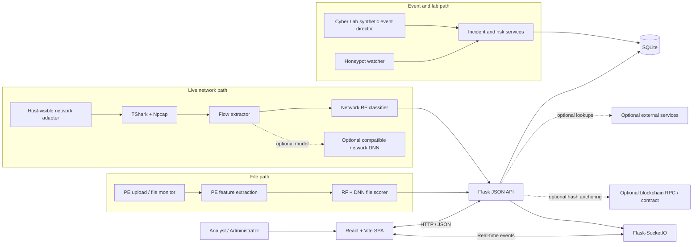

# CyberDefense-AI — Complete Project Dossier

> **Purpose of this document:** This file is the single, detailed technical source for understanding the project and preparing a semester/project report. It describes the implementation as it exists in this repository, separates measured metadata from assumptions, and calls out important limitations. Treat paths, model metadata, and implementation notes here as the evidence base; verify any new runtime or experimental results before adding them to an academic report.

## Abstract

CyberDefense-AI is a local-first defensive security monitoring and analysis application. It combines a React web interface, a Python/Flask API, SQLite persistence, machine-learning-assisted file analysis, host-visible network packet capture, network-flow classification, honeypot decoys, incident records, and optional enrichment and integrity services. The interface is split into a broad Security Operations Center (SOC) workspace and a dedicated ransomware-analysis workspace.

The application has two distinct analysis paths. In the file path, a PE file is converted to a fixed set of executable metadata features and passed to a ransomware classifier. In the live network path, TShark reads packets visible to the host adapter, a flow extractor aggregates packet-derived features, and the trained network classifier evaluates a flow. The API marks a live network attack as confirmed only when inference succeeds, required features are valid, the predicted class is non-benign, and confidence meets the configured 70% gate. Cyber Lab scenarios are a third, separate path: they emit synthetic events to exercise event and incident views, but do not create network packets or become trained-model-verified live attacks.

This is a development and educational defensive platform, not a production endpoint detection and response (EDR) product. Its behavior depends on model assets, operating-system permissions, capture visibility, dependencies, and optional third-party services. Reported model scores in metadata are not guarantees of accuracy on new traffic.

## Project identity and scope

| Item | Description |
| --- | --- |
| Project name | CyberDefense-AI |
| Project type | Full-stack defensive security monitoring and analysis platform |
| Primary users | Security analysts and administrators in a local or authorized lab |
| Main purpose | Bring file analysis, visible network activity, alerts, incidents, and lab demonstrations into one application |
| Frontend | React 18 and Vite single-page application |
| Backend | Python 3.10+ Flask API, Flask-SocketIO real-time events |
| Persistence | Local SQLite database plus backend-local files |
| Network capture | TShark/Wireshark and Npcap where available; OS connection monitoring is a separate fallback |
| ML roles | PE/ransomware classification; network flow classification; optional anomaly scoring |
| Operating boundary | Only monitor systems and networks for which the operator has permission |

### Academic submission details supplied

The following details were supplied for the semester-project report. Confirm spelling,
registration numbers, institutional titles, and the final submission date against
official records before submission.

| Item | Supplied detail |
| --- | --- |
| Institution | University of Engineering & Management, Jaipur |
| Department | Department of Computer Science and Engineering |
| Degree | Bachelor of Technology |
| Academic session | 2023--2027 |
| Project title | CyberDefense-AI Platform |
| Report subtitle | AI-Assisted Security Operations, Live Network Intrusion Detection, and Ransomware Analysis |
| Student | Gagandeep Singh Shekhawat — 12023002001008; registration number 204202300200017 |
| Student | Deepak Kumar Sahu — 12023002001117; registration number 204202300200144 |
| Student | Rahul Saini — 12023002001139; registration number 204202300200122 |
| Project guide | Prof. Soumen Sarkar |
| Department representative | Prof. Dr. G Uma Devi, Associate Dean / Head of Department, CSE |
| Place | Jaipur |
| Submission date | Not supplied; enter the actual date |

### Problem addressed

Security information in a small lab or demonstration environment can be fragmented across packet tools, file scanners, logs, and incident notes. This project provides a common interface for observing host-visible network traffic, running file scans, organizing event context, and demonstrating analyst workflows. It also separates synthetic training scenarios from network observations so a lab event is not mistaken for a captured packet.

### Project evolution

The supplied report describes this work as a continuation of an earlier semester
project, not as a replacement of its foundation. The earlier work established the
application structure, ransomware-oriented file analysis, and associated security
dashboard and integration work. The current development retains the file-analysis
workflow while expanding network packet observation and flow-based classification,
the SOC and investigation views, incident and evidence workflows, and synthetic
Cyber Lab scenarios.

This is the project history as described for the academic report. Do not attribute
specific earlier-version metrics or implementation details to the current source
unless they are separately verified.

### Goals

1. Provide separate but related SOC and ransomware-analysis workspaces.
2. Capture packets from an authorized, host-visible network interface when capture software and permissions allow.
3. Convert packet observations into flow features and request a trained-model classification.
4. Refuse to call a live network flow a verified attack if the model is absent, required features are invalid, or confidence is below the gate.
5. Scan PE-compatible files using executable metadata features and preserve scan results.
6. Store security events and incidents locally for investigation.
7. Provide decoy honeypot resources and controlled synthetic Cyber Lab scenarios.
8. Support optional enrichment, notification, AI assistance, and blockchain integrity integrations.

### Non-goals

- Capturing all traffic on a Wi-Fi network from an ordinary client adapter.
- Decrypting TLS or other encrypted application traffic.
- Replacing enterprise EDR, SIEM, firewall, antivirus, or incident-response processes.
- Treating any model score as a calibrated probability or definitive proof of an attack.
- Using Cyber Lab scenarios to produce real scans, brute-force attempts, denial-of-service traffic, or exfiltration.
- Guaranteeing that a model trained on one dataset generalizes to all networks, files, or adversaries.

## Functional requirements and user roles

### Functional requirements

- Authenticate users and issue time-limited API tokens.
- Provide a file-analysis workflow and store its result.
- Display network packets, flows, capture status, and model-verified alerts separately.
- Provide security-event and incident views with investigation context.
- Enable and disable a guarded synthetic lab mode; validate scenario identifiers and limit concurrency.
- Display decoy resources and honeypot activity.
- Offer administration and optional integration pages.

### Roles

| Role | Intended access |
| --- | --- |
| Analyst | Normal dashboard, scan, network, incident, lab, and investigation workflows |
| Admin | Analyst workflows plus administrative user/system operations |

The frontend applies protected and admin-only route wrappers. The backend also performs bearer-token checks on protected API endpoints. A route guard in a client is a usability feature, not a substitute for server authorization.

## System context and architecture

### Logical architecture



The component arrows represent logical relationships, not a guarantee that every optional component is active in a particular run. Runtime status and backend logs are authoritative for whether a component actually started.

### Component responsibilities

| Component | Responsibility | Main implementation |
| --- | --- | --- |
| React single-page app | Login, workspace navigation, dashboards, status, scan, investigation, and lab controls | `frontend/src/App.jsx`, `frontend/src/pages/` |
| API client | Sends JSON/multipart requests and bearer tokens to the local API | `frontend/src/api.js` |
| Flask app | Authentication, routes, file/network orchestration, initialization and event handlers | `backend/app.py` |
| Socket server | Pushes event updates to connected browser clients | Flask-SocketIO initialized in `backend/app.py` |
| SQLite helpers | Create and query application tables | `backend/utils/db.py` |
| Incident manager | Incident lifecycle, serialization, and incident event emission | `backend/utils/incident_manager.py` |
| File feature extractor/scorer | Extracts PE metadata and classifies file features | `backend/models/file_monitor.py`, `backend/models/threat_scorer.py` |
| Packet capture | Starts/stops TShark, parses packets, maintains capture state | `backend/utils/tshark_capture.py` |
| Flow extractor | Aggregates packet fields and calculates classifier inputs | `backend/utils/flow_extractor.py` |
| Network scorer | Loads classifiers, scores feature vectors, and returns a verified/unverified result | `backend/models/network_scorer.py` |
| OS network monitor | Supplies host connection context and heuristic candidates | `backend/models/network_monitor.py` |
| Honeypot | Creates fake decoy files, watches filesystem activity, and records triggers | `backend/utils/honeypot.py` |
| Cyber Lab | Emits bounded synthetic scenarios and status/log events | `backend/utils/attack_director.py` |
| Risk and evidence | Calculates explainable risk factors and local evidence bundles | `backend/utils/risk_scorer.py`, `backend/utils/forensic_evidence.py` |
| Optional integrations | AI, email, webhooks, geolocation, threat intelligence, blockchain | `backend/utils/` integration modules |

### High-level architecture patterns

- **Client/server:** React consumes a Python HTTP API.
- **Push updates:** Socket.IO delivers selected live event types without requiring a page reload.
- **Local persistence:** SQLite stores historical application records.
- **In-process state:** some packet, flow, alert, and scenario state is held in Python memory and is reset when the backend process restarts.
- **Optional adapters:** external providers and blockchain are integration points, not requirements for basic local operation.
- **Separate data paths:** file scoring, network flow scoring, OS-connection heuristics, and simulated events are distinct sources and should retain their provenance.

## Workspaces and user interface

The application uses one backend and database with two UI workspaces. The workspace switcher changes the page group; it does not start a second service or isolate the data store.

### SOC workspace

| Page | Route | Main purpose |
| --- | --- | --- |
| SOC Dashboard | `/` | Summary metrics, security activity, health, and links to alerts/incidents |
| Threats | `/threats` | Stored file-analysis results |
| Analytics | `/analytics` | Visual summaries from application data |
| Blockchain | `/blockchain` | Blockchain status, records, and verification tools when configured |
| Admin | `/admin` | User/system administration; admin role required |
| SOC War Room | `/soc` | Operational event and incident view |
| Chat | `/chat` | Optional AI-assisted analyst interface |
| Audit Log | `/audit` | Recorded user/system audit activity |
| Network | `/network` | Capture status, packet/flow details, and verified network alerts |
| Cyber Lab | `/lab` | Explicitly enabled synthetic scenarios, logs, and stop/reset controls |
| Incidents | `/incidents` | Incident list |
| Incident detail | `/incidents/:id` | Incident summary and investigation tabs |

Incident detail areas include overview, attacker context, investigation, timeline, attack graph, evidence, and replay, subject to available data and integrations.

### Ransomware workspace

| Page | Route | Main purpose |
| --- | --- | --- |
| Ransomware Center | `/ransomware` | Dedicated ransomware/file-analysis dashboard |
| Ransomware History | `/ransomware-history` | Stored ransomware-related file scan records |

The file-scanning data is shared with the wider app; the workspace provides a distinct user experience rather than separate storage.

## End-to-end workflows

### A. Live network observation and alert workflow

1. Backend initialization creates a TShark capture service and flow extractor.
2. TShark lists available interfaces. Startup tries to match a local IP address to an interface and starts capture on a match.
3. TShark emits parsed packet fields such as protocol, addresses, ports, lengths, flags, and timestamps.
4. The flow extractor groups packets into directional/bidirectional conversations and calculates features according to the saved model schema.
5. The network scorer checks that the model is loaded and every required model feature is present and finite.
6. The RF classifier runs. If a compatible DNN is loaded, the scorer attempts an ensemble; if the DNN is unavailable or inference fails, it can continue with the RF result.
7. The app stores a flow in its in-memory live-flow collection.
8. A live network alert is made only if the model result is verified, non-benign, and at least 70% confidence. A duplicate flow/class alert is throttled.
9. The API and Socket.IO publish flow/alert state to the Network and SOC interfaces.

**Failure behavior:** unavailable model, feature mismatch, non-finite values, or failed inference yields an unverified/unknown result and must not be displayed as a verified live network attack.

### B. File scan workflow

1. An authenticated user uploads a file using the UI, or submits a feature vector to the prediction endpoint.
2. The upload endpoint writes the upload to a temporary file and attempts PE feature extraction.
3. The file scorer applies its saved feature schema and the available RF/DNN models.
4. The result includes a class, score, model confidence fields, a short feature explanation, a timestamp, and a SHA-256 result hash.
5. The result is stored in the `threats` table. The API may also emit a file-scan or high-threat event and may start optional AI summary/notification work.
6. Threat and ransomware pages retrieve persisted records from the API.

The classifier targets PE executable metadata. An arbitrary non-PE document or unsupported file is not necessarily analyzable by this workflow.

### C. Honeypot workflow

1. Startup initializes decoy resources under `backend/lab/honeypot/`.
2. When the filesystem watcher is available, it observes selected operations on known decoy filenames.
3. A qualifying real filesystem event is stored/emitted as a honeypot trigger.
4. A Cyber Lab scenario may separately create a scenario-tagged simulated trigger.
5. The source/provenance should be retained: a lab trigger is not evidence that an external actor opened a decoy.

### D. Cyber Lab workflow

1. An authenticated user turns on **SIMULATION MODE**.
2. The API validates the requested scenario ID against `SIMULATION_MAP`.
3. The attack director refuses a concurrent running scenario and returns a scenario ID when it starts.
4. Synthetic events and logs are delivered to event/incident and Lab/SOC views with the scenario ID.
5. Stop requests signal cooperative cancellation; status/log routes report the scenario.

The Lab API does not generate packets, conduct a scan, authenticate against services, transfer user data, or run live ransomware. Synthetic records can be visible in incident/event areas by design. They are not part of the trained-model-verified packet alert stream.

## Live packet capture: meaning and boundaries

### What packet capture means here

The capture process uses TShark (Wireshark's command-line dissector) and Npcap on Windows. The backend selects or accepts a capture interface; it consumes the packets made visible by the operating system and interface. Packet rows describe metadata (for example endpoints, ports, protocol, packet length, timestamp, and decoded information) rather than guaranteeing access to application content.

### Wi-Fi limits

- Normal Wi-Fi client operation typically exposes traffic to/from this host, not all traffic between other wireless clients and the access point.
- Promiscuous mode alone does not make an ordinary adapter a monitor-mode radio and does not decrypt other clients' traffic.
- TLS/QUIC application payloads are encrypted. IPs, ports, protocol, lengths, and timing can still be visible.
- A remote endpoint's IP is not its MAC address. Routers do not forward the remote endpoint's layer-2 MAC through the internet.
- Public IP geolocation and ISP labels are approximate enrichment, not packet-capture facts. Private/reserved IPs often cannot be enriched.
- IPv4 and IPv6 addresses are supported when the capture dissector supplies their fields.

### Capture prerequisites and fallback

| Requirement | Why it matters |
| --- | --- |
| TShark installed and discoverable | Interface enumeration and packet decoding |
| Npcap installed on Windows | Capture driver for supported Windows adapters |
| Correct adapter selected | Capture only sees the selected interface's traffic |
| Sufficient OS privileges | Some adapters/drivers require elevated access |
| Compatible capture mode/driver | Hardware and driver determine which packets are visible |
| Model artifacts/schema available | Capture alone does not produce a verified attack classification |

The OS connection monitor can show some local connection context when packet capture is not active. It is not packet capture: it cannot reproduce the packet table or provide packet-derived model features.

## Machine-learning models and confidence semantics

This section deliberately distinguishes (a) stored model metadata and code behavior from (b) validated, reproducible claims. Probability-like values returned by classifiers are model scores; unless a calibration procedure and independent evaluation are documented, they must not be described as calibrated real-world probabilities.

### Model inventory

| Model path / purpose | Algorithm and schema | Classes or output | Current role |
| --- | --- | --- | --- |
| PE file RF: `backend/models/rf_model.pkl` | Scikit-learn Random Forest; 15 PE metadata features | Binary ransomware/benign probability, with class orientation inferred using synthetic anchor vectors | Primary file score contributor |
| PE file DNN: `backend/models/dl_model.pth` | PyTorch feed-forward network; metadata has 15 inputs and source defines 128 → 64 → 32 → 1 with BatchNorm/ReLU/dropout | Sigmoid output, orientation checked against synthetic anchors | Secondary file score contributor |
| Network RF: `backend/models/network_rf_model.pkl` | Random Forest; metadata reports 200 trees, max depth 15, 75 features | `BENIGN`, `BRUTE_FORCE`, `DOS`, `PORT_SCAN`, `WEB_ATTACK` | Primary live flow classifier |
| Network DNN: `backend/models/network_dl_model.pth` | PyTorch LayerNorm/GELU model; metadata currently reports 46 inputs and 8 classes | Metadata classes: `BENIGN`, `BOTNET`, `BRUTE_FORCE`, `DDOS`, `DOS`, `INFILTRATION`, `PORT_SCAN`, `WEB_ATTACK` | Optional; not currently schema/class compatible with the 75-feature, five-class live RF configuration |
| Network anomaly model: `backend/models/network_anomaly_model.pkl` | Adapter around an anomaly classifier, where compatible | Anomaly score / anomaly flag | Optional secondary signal; disabled if its feature count does not match the network feature schema |
| NSL-KDD RF/DNN: `backend/models/network_nslkdd_*` | Separate 41-feature NSL-KDD pipeline | Metadata lists five classes; scores are in the NSL-KDD metadata | Supplementary model files; not the packet-flow classifier path used by `predict_flow` |

Model binary files (`.pkl`, `.pth`) are excluded by the repository's `.gitignore` because of size. They must be provisioned locally and verified against the corresponding JSON metadata. A clean clone may contain scorer code and metadata without the trained binary assets.

### PE model input features

The file scorer expects the following 15 keys. Values are extracted from PE headers/sections or derived by the file feature extractor:

| # | Feature key | General interpretation |
| ---: | --- | --- |
| 1 | `Machine` | Target processor/machine type |
| 2 | `DebugSize` | Debug-directory size |
| 3 | `DebugRVA` | Relative virtual address of debug data |
| 4 | `MajorImageVersion` | PE image version |
| 5 | `MajorOSVersion` | Target OS version |
| 6 | `ExportRVA` | Export directory relative virtual address |
| 7 | `ExportSize` | Export directory size |
| 8 | `IatVRA` | Import-address-table feature key as named by the current model |
| 9 | `MajorLinkerVersion` | PE linker major version |
| 10 | `MinorLinkerVersion` | PE linker minor version |
| 11 | `NumberOfSections` | Number of PE sections |
| 12 | `SizeOfStackReserve` | Stack reserve size |
| 13 | `DllCharacteristics` | PE DLL characteristic flags |
| 14 | `ResourceSize` | Resource-section size |
| 15 | `BitcoinAddresses` | Extractor's indicator/count feature for Bitcoin-address strings |

The feature spelling `IatVRA` is retained because it is what the model implementation declares. Do not silently rename a model feature without retraining/updating all related artifacts.

### File classifier score and labels

The implementation:

1. Gets a ransomware probability from the RF (`p_RF`).
2. Gets an oriented ransomware probability from the DNN (`p_DNN`).
3. Combines them as `p_combined = 0.85 × p_RF + 0.15 × p_DNN`.
4. Uses the RF binary class threshold of 0.5 to distinguish the ransomware branch. When RF says ransomware, the code sets `threat_score = min(70 + 30 × p_RF, 100)`. Otherwise, the score is `100 × p_combined`.
5. Assigns labels using the implemented score comparisons:

| Condition in implementation | Label | Risk level |
| --- | --- | --- |
| `threat_score > 70` | `Ransomware` | `HIGH` |
| `30 < threat_score <= 70` | `Suspicious` | `MEDIUM` |
| `threat_score <= 30` | `Benign` | `LOW` |

`ml_confidence` is the RF ransomware probability expressed as a percentage; `dl_confidence` is the DNN ransomware probability as a percentage. These are model outputs, not calibration-adjusted likelihoods. Because the ransomware branch adds a 70-point base to `p_RF × 30`, an RF-positive result at `p_RF >= 0.5` maps to at least an 85-point threat score. This is the current scoring implementation and should be described as such rather than as a conventional probability threshold.

The current prediction response's `top_features` list takes the first entries in the stored SHAP-values JSON key order, and the explanation text labels them as top indicators. This is not a per-file SHAP computation in the displayed prediction function. Treat it as a model-wide feature summary unless a separate per-sample explainer is added and validated.

### Live network model input schema

The network RF metadata declares 75 CICFlowMeter-style features. The flow extractor produces the feature vector, including traffic volume/rates, directional packet lengths, inter-arrival times, flags, header/segment sizes, subflow counts, window sizes, active/idle statistics, and bulk statistics.

Representative keys include:

| Feature group | Examples |
| --- | --- |
| Flow totals/rates | `Flow Duration`, `Flow Bytes/s`, `Flow Packets/s` |
| Directional packet counts/bytes | `Total Fwd Packets`, `Total Backward Packets`, `Total Length of Fwd Packets` |
| Packet lengths | `Fwd Packet Length Mean`, `Bwd Packet Length Max`, `Packet Length Variance` |
| Timing | `Flow IAT Mean`, `Fwd IAT Std`, `Bwd IAT Max`, `Active Mean`, `Idle Mean` |
| TCP flags | `SYN Flag Count`, `ACK Flag Count`, `RST Flag Count`, `FIN Flag Count`, `ECE Flag Count` |
| Directional behavior | `Fwd PSH Flags`, `Bwd URG Flags`, `Down/Up Ratio` |
| Headers/windows | `Fwd Header Length`, `Bwd Header Length`, `Init_Win_bytes_forward` |
| Subflows/bulk | `Subflow Fwd Packets`, `Subflow Bwd Bytes`, `Fwd Avg Bytes/Bulk` |

The full, ordered feature list is stored in `backend/models/network_model_info.json`. The **order matters** when constructing the model vector. The scorer refuses missing, null, or non-finite required values instead of silently padding them with zero.

### Network classifier combination and verification

The current `predict_flow` implementation:

- Uses the RF class probability vector as its primary output.
- If an optional DNN is successfully loaded and its forward pass succeeds, combines class probabilities as `0.65 × RF + 0.35 × DNN`.
- Otherwise uses the RF probabilities alone.
- Selects the class with the largest resulting score; `confidence` is that winning score multiplied by 100.
- Sets `is_attack` for a non-`BENIGN` result at confidence of at least 70%.
- Returns an unverified result if model loading, required-feature checks, input validation, or inference fails.

The application has a second explicit gate before recording a confirmed live network alert: the result must be model-verified and non-benign, have at least 70% confidence, and identify an accepted loaded model. A rule-based candidate by itself does not pass this gate.

**Confidence interpretation:** the percentage is the model's winning class score/probability output after the optional ensemble. It is not documented as calibrated, and 70% is an application threshold, not proof that the real-world event has a 70% chance of being malicious. A benign high-confidence prediction is not an attack.

### Important network DNN compatibility caveat

The checked-in RF metadata declares **75 features and five classes**. The checked-in network DNN metadata declares **46 input features and eight classes**. Those schemas/classes do not match. The scorer attempts to load the DNN architecture from its metadata, but a DNN input incompatible with the RF flow vector cannot contribute to the 75-feature live prediction; the DNN inference path catches inference failure and continues with RF-only probabilities. In addition, PyTorch can fail to initialize on a given Windows/Python installation. Therefore, document the current live classifier as **RF-primary**; describe the DNN ensemble as intended/conditional unless a matching DNN artifact is trained, installed, loaded, and verified with a runtime test.

The scorer also checks that the optional anomaly model's feature count matches the RF feature schema. If it does not, anomaly scoring is disabled. This does not prevent the compatible RF path from running.

### Model metadata results: how to report them

| Metadata source | Value recorded in repository | Correct academic wording |
| --- | --- | --- |
| `network_model_info.json` | `rf_accuracy: 100.0`, 200 estimators, max depth 15, `sample_count: 800`, five classes | “The local metadata records 100% RF accuracy for an 800-sample evaluation.” State that the split/protocol and independent reproduction must be checked; do not claim 100% field accuracy. |
| `network_nslkdd_info.json` | 100,250 total samples; RF accuracy/F1 99.58; DNN accuracy 97.38 and F1 97.47; 41 features; five classes | “The supplementary model metadata reports these NSL-KDD evaluation values.” Confirm split, averaging, and reproducibility before making comparative claims. |
| `dl_model_info.json` | Declares input dimension 15 and the PE feature names; no evaluation metric in that metadata file | Do not quote the source-code comment about 99.62% as a reproduced result unless the original evaluation dataset, split, and run output are available. |
| `network_dl_model_info.json` | Declares the 46-input/eight-class DNN architecture | The metadata does not establish that this model is compatible with the current 75-feature/five-class live RF path. |

No calibration curve, expected calibration error, Brier score, per-class precision/recall table, independent test protocol, or live field benchmark is established by the metadata listed here. If a semester report includes those measures, it must run and record a reproducible evaluation; it must not invent them from an accuracy field.

### Suggested ML evaluation for a semester report

For an experimentally defensible results chapter:

1. Record exact dataset names, versions, licenses, sample counts, label mappings, and preprocessing.
2. Record a reproducible train/validation/test split or cross-validation design, including whether flows/hosts from the same source can leak across splits.
3. Train each model using the same documented split when comparing them.
4. Report confusion matrix, per-class precision, recall, F1, macro/weighted averaging, accuracy, and support.
5. Measure the decision threshold's precision/recall trade-off; show why the deployed 70% gate was selected.
6. If probability meaning matters, fit and validate calibration separately (for example reliability diagrams and Brier score) on data not used to train the classifier.
7. Record runtime dependencies, model artifact hashes, feature schema version, random seeds, and exact commands.
8. Validate on a safe, authorized test environment and clearly separate real captured traffic from synthetic scenarios.
9. Report limitations and false-positive/false-negative examples; do not infer generalization from training accuracy.

## Risk score, events, and incidents

### Risk score

`backend/utils/risk_scorer.py` calculates an explainable 0–100 prioritization score from available signals. The configured maximum weights are:

| Signal | Maximum weight |
| --- | ---: |
| ML prediction | 25 |
| File activity | 15 |
| Honeypot activity | 25 |
| Network anomaly | 25 |
| Process anomaly | 5 |
| Multi-signal correlation | 5 |
| **Total nominal weight** | **100** |

Network alert type and severity can modify the network contribution. Signal confidence also scales a factor's contribution. The score is a triage score, not an ML posterior probability or the same thing as the classifier's confidence. The incident record stores risk score, risk level, and a serialized factor explanation.

### Event versus incident versus alert

| Record | Meaning |
| --- | --- |
| Packet | A packet observed by the capture process |
| Flow | A group/summary of packet observations |
| Candidate | A heuristic or rule observation that may warrant inspection |
| Verified live network alert | A flow result passing the trained-model availability, validation, class, and confidence gates |
| Security event | A normalized observation from a source such as file, honeypot, or simulation |
| Incident | A stored analyst case that groups event details, context, severity, risk, and investigation material |
| Simulation event | Synthetic scenario output; it may appear in SOC/event/incident UI but is not a captured packet |
| Threat scan record | A file prediction persisted for history and review |

Not every field in an incident is a direct observation. Geolocation, process identity, threat-intelligence enrichment, and simulation context may be unavailable or derived. Check provenance and scenario IDs before making conclusions.

## Database and data dictionary

The default SQLite database path is `backend/cyberdefense.db`. `backend/utils/db.py` initializes the general tables; `backend/utils/incident_manager.py` creates the incident table. Names below are based on the current schema in code.

### `threats`

Stores file-analysis results.

| Column | Purpose |
| --- | --- |
| `id` | Auto-incrementing record identifier |
| `file_name` | Submitted or observed file name |
| `features` | JSON-serialized PE features used for prediction |
| `prediction` | File classifier label |
| `threat_score` | File threat score |
| `blockchain_hash` | SHA-256 of the returned prediction summary; not by itself proof of chain submission |
| `timestamp` | Scan time |
| `ai_summary` | Optional asynchronous analyst summary |
| `mitre_tactics` | Formatted MITRE ATT&CK mapping string |

### `security_events`

Stores normalized security telemetry, including scenario-linked events.

| Column | Purpose |
| --- | --- |
| `id` | Internal row identifier |
| `event_id` | Event identifier with a uniqueness constraint |
| `timestamp` | Event time |
| `event_type`, `severity` | Event classification and severity |
| `scenario_id` | Lab scenario identifier when the event is simulated |
| `source_ip`, `source_port`, `dest_ip`, `dest_port`, `protocol` | Available network endpoint context |
| `process_name`, `process_pid`, `file_name` | Available host/file context |
| `attack_type` | Event's attack or activity category |
| `honeypot` | Honeypot indicator |
| `description` | Human-readable description |
| `raw_json` | Serialized event details |

### `incidents`

Stores incident lifecycle and investigative context. It is initialized by the incident manager.

| Column group | Representative fields |
| --- | --- |
| Identity/state | `id`, `scenario_id`, `title`, `status`, `created_at`, `updated_at`, `closed_at` |
| Classification/priority | `attack_type`, `severity`, `risk_score`, `risk_level`, `risk_factors`, `response` |
| Network context | `source_ip`, `source_port`, `dest_ip`, `dest_port`, `protocol`, `source_mac` |
| Host/file context | `process_name`, `process_pid`, `process_path`, `file_name`, `file_sha256`, `files_affected` |
| Honeypot/model | `honeypot_hit`, `honeypot_resource`, `ml_prediction`, `ml_confidence` |
| Evidence/integrity | `evidence_hash`, `blockchain_tx` |
| Enrichment/timeline | `geo_info`, `timeline`, `events` |

### `honeypot_triggers`

| Column | Purpose |
| --- | --- |
| `id` | Internal row identifier |
| `event_id`, `timestamp` | Event reference and time |
| `resource`, `operation` | Decoy resource and observed/simulated operation |
| `process_name`, `process_pid` | Available process context |
| `source_ip` | Available source context; often absent for local file activity |
| `scenario_id` | Present for a simulated lab trigger |

### `simulation_log`

| Column | Purpose |
| --- | --- |
| `id` | Internal row identifier |
| `scenario_id` | Scenario instance |
| `timestamp` | Log time |
| `message` | Human-readable step or status |
| `sim_type` | Scenario type |

### `audit_log`

| Column | Purpose |
| --- | --- |
| `id` | Internal row identifier |
| `timestamp` | Audit time |
| `username` | Actor, when known |
| `action` | Action name |
| `details` | Action details |

### `network_audit_log`

| Column | Purpose |
| --- | --- |
| `id`, `timestamp` | Row identifier and time |
| `event_type`, `severity` | Network event class and severity |
| `ip`, `protocol`, `port` | Endpoint context |
| `description`, `details` | Human-readable and serialized context |

### `users`

| Column | Purpose |
| --- | --- |
| `id` | User row identifier |
| `username` | Unique login name |
| `password` | Current implementation stores a SHA-256 digest |
| `role` | Authorization role (such as `admin` or `analyst`) |

The current password implementation is not appropriate for production: plain SHA-256 is not a password-hashing scheme with a salt/work factor. Treat the seeded accounts and password storage as development limitations.

### Persistence limits

- SQLite-backed tables persist locally across normal application restarts.
- Network packet/flow/alert lists and some dashboard counters are process-memory state and may reset on restart.
- Evidence JSON bundles are written under `backend/evidence/` when preservation is invoked.
- Honeypot decoys and lab demo files live under backend-local directories.
- `backend/watched/` is monitored by file-monitor code; inspect contents before any manual cleanup.
- The local database may contain sensitive observations and should be protected as such.

## Cyber Lab and simulation scenarios

Cyber Lab is designed to demonstrate event handling, not to conduct real attacks. The API requires a valid bearer token, a boolean-enabled lab mode, and a recognized type from the scenario allowlist. It prevents concurrent starts and supports cooperative stop.

| Scenario ID | Synthetic behavior | Real-world action? |
| --- | --- | --- |
| `ransomware` | Creates clearly labeled synthetic PE-like demo files and a demo ransom note under the watched directory; may emit decoy interaction events | No real encryption or modification of unrelated personal documents |
| `portscan` | Emits port-scan-shaped event telemetry and a consolidated alert | Does not connect to or scan ports |
| `brute-force` | Emits login-attempt-shaped telemetry | Does not try credentials |
| `phishing` | Emits a staged phishing event sequence and may create a demo payload file | Does not send mail or contact a C2 server |
| `suspicious-process` | Emits process-context events and synthetic file activity | Does not launch real malware |
| `data-exfiltration` | Emits simulated data-volume/transfer telemetry | Does not upload local data |
| `honeypot` | Records a synthetic decoy-resource trigger | No external actor is involved |
| `full-attack` | Emits a multistage synthetic narrative | Does not execute the represented attack chain |

### Live versus simulated signal matrix

| Property | Live capture | Cyber Lab scenario |
| --- | --- | --- |
| Packet source | TShark/Npcap and host-visible adapter | No packets |
| Endpoint origin | Parsed from actual captured packet headers | May contain synthetic example values |
| Model inference | Run on captured flow features when valid | Not run on synthetic event descriptions |
| Live verified network alert count | Eligible only after model verification and threshold checks | Not eligible |
| SOC/event/incident UI | Displays observations and verified alerts | Can display simulated events with a `scenario_id` |
| Purpose | Observe and classify visible network flows | Exercise scenario/event/incident UI and analyst workflow |

Simulation mode is a process-local backend flag and starts disabled. It resets after backend restart. Enabling it does not stop or enable packet capture.

### Synthetic files and cleanup safety

The ransomware and phishing demonstrations can write files in `backend/watched/`. Do not recursively delete the directory: it is an application watch location and may contain other files. If removing demo artifacts, identify only the exact files created by the scenario and review them individually.

## Honeypot, incident evidence, and response context

### Honeypot resources

The honeypot module defines seven fake decoy resources:

- `financial_report_Q4.xlsx`
- `employee_data.xlsx`
- `passwords.txt`
- `backup.zip`
- `credentials.db`
- `ssh_private_key.pem`
- `database_backup.sql`

The files contain explicit fake/decoy text. The watcher is best-effort and depends on the Watchdog observer and operating-system event semantics. A trigger's process attribution may be incomplete; a simulation trigger is scenario-tagged and must not be reported as a real compromise.

### Incident risk and lifecycle

An incident can store title, type, severity, IP/port/protocol fields, process/file context, honeypot status, model fields, risk factors, evidence pointers, geolocation, timeline and events. The incident manager supports create/update and emits incident events to connected clients. A high severity or risk score can prioritize analyst attention; it is not a probability guarantee.

### Forensic evidence

The evidence utility can serialize incident information, related events, honeypot events, model analysis and response data into a local JSON bundle. It calculates a SHA-256 hash and supports recomputation/verification. Hash matching detects content changes relative to the expected hash; it does not independently prove the truth of the collected telemetry.

### Optional blockchain integrity

The blockchain module can submit hashes/records through a Web3 RPC/contract configuration. It may use Core Testnet2. Chain availability, gas/test tokens, contract address, key, network settings, and provider response determine success. A testnet transaction is a demonstration, not production evidence custody. Never publish a wallet private key.

## Optional enrichment, alerts, and AI

| Integration | Use | Configuration / caveat |
| --- | --- | --- |
| IP geolocation | Approximate public-IP location/provider metadata | `IPINFO_TOKEN` and/or provider availability; private/reserved IPs commonly yield no location |
| AbuseIPDB | IP reputation lookup | `ABUSEIPDB_API_KEY`; quota and API availability apply |
| Shodan | Public host/service context | `SHODAN_API_KEY`; not a definitive identity or vulnerability assessment |
| VirusTotal | File-hash reputation lookup | `VIRUSTOTAL_API_KEY`; hash lookup is subject to provider quota and coverage |
| ChatGPT-compatible provider | Analyst chat or summaries | One of `GEMINI_API_KEY`, `GROQ_API_KEY`, `OPENAI_API_KEY`; provider/model selection is code-dependent |
| Email | Optional security email notices | `EMAIL_ENABLED`, `EMAIL_SENDER`, `EMAIL_PASSWORD`, `EMAIL_RECEIVER` |
| Webhook | Optional Slack/Discord-style notices | `WEBHOOK_URL`; treat the URL as a secret |
| Blockchain | Record/verify hashes | `ETH_RPC_URL`, `CONTRACT_ADDRESS`, `WALLET_PRIVATE_KEY`, `CHAIN_ID` |

These integrations are optional. An absent key, quota, private address, unsupported response, offline network, or provider error can leave fields unavailable. Unknown enrichment is not proof of safety.

## API and real-time interface

### API conventions

- Local API base used by the frontend: `http://localhost:5000/api`.
- Login accepts JSON username/password and returns a signed bearer token, role, and username.
- Protected endpoints expect `Authorization: Bearer <token>`.
- The token expiry configured in the login route is eight hours.
- Most data endpoints require authentication; the basic `/health` liveness route is public.
- Exact parameters and response bodies should be read from the corresponding route in `backend/app.py`.

### Endpoint inventory

All paths below are relative to `/api`.

| Area | Method and route | Purpose |
| --- | --- | --- |
| Authentication | `POST /login` | Authenticate and issue JWT |
| Authentication | `GET /verify-token` | Validate current token |
| File prediction | `POST /predict` | Predict using a submitted feature object |
| PE upload | `POST /upload-scan` | Upload a file for PE feature extraction and scoring |
| Threat history | `GET /threats`, `GET /stats` | Retrieve file results and summary metrics |
| System liveness | `GET /health` | Basic public health response |
| Component health | `GET /system/health` | Authenticated component health details |
| Capture setup | `GET /interfaces` | List capture interfaces |
| Capture control | `POST /capture/start`, `POST /capture/stop` | Start or stop capture |
| Capture status | `GET /capture/status`, `GET /system/status` | Capture and process status |
| Network data | `GET /flows`, `GET /alerts`, `GET /attackers` | Live in-process flow, alert, and attacker collections |
| Network legacy/context | `GET /network/connections`, `/network/stats`, `/network/alerts`, `/network/packets`, `/network/audit-log` | OS/network monitor data and compatibility routes |
| Security records | `GET /events`, `GET /incidents` | Retrieve events and incidents |
| Incident detail | `GET /incidents/<id>` | Retrieve one incident |
| Investigation | `GET /incidents/<id>/investigate`, `/evidence`, `/replay`, `/attack-graph` | Investigation views |
| Honeypot | `GET /honeypot/files`, `/honeypot/triggers`, `/honeypot/status` | Decoy file and trigger data |
| Cyber Lab | `GET/POST /lab/mode` | Read/change synthetic lab mode |
| Cyber Lab | `POST /lab/simulate`, `GET /lab/status`, `POST /lab/stop`, `POST /lab/reset` | Start, inspect, stop, and reset lab state |
| Cyber Lab | `GET /lab/logs/<scenario_id>`, `GET /lab/scenarios` | Read scenario logs and available scenarios |
| Enrichment | `GET /geo/<ip>`, `/intel/ip/<ip>`, `/intel/ip/<ip>/abuse`, `/intel/ip/<ip>/shodan`, `/intel/hash/<hash>`, `/intel/status` | Optional enrichment endpoints |
| Evidence/risk | `GET /evidence`, `POST /evidence/verify`, `POST /risk-score` | Evidence listing/verification and risk scoring |
| Administration | `/admin/...` | User and system operations; server-side admin checks apply |
| Blockchain | `/blockchain/...` | Blockchain log/status/verification routes |
| Audit/report | `/audit-log`, `/report`, `/threats/export/csv` | Audit, report, and CSV endpoints |

The endpoint inventory summarizes routes; it does not override the actual HTTP methods or authorization checks in `backend/app.py`.

### Socket.IO event examples

The frontend and backend use event names including:

| Event name | General purpose |
| --- | --- |
| `security_event` | A security-event payload |
| `soc_update` | SOC feed update |
| `live_incident` | Incident card/update |
| `incident_created` | Incident lifecycle notification |
| `alert_created` | Network alert notification |
| `network_alert` | Network alert display update; inspect provenance/verification fields |
| `attacker_update` | Live attacker summary update |
| `capture_status` | Capture start/stop state |
| `sim_log` | Synthetic Lab scenario log line |
| `honeypot_triggered` | Honeypot event notification |
| `file_scanned`, `high_threat_alert` | File scan/high-threat UI events |

A `scenario_id` indicates synthetic scenario provenance. Do not collapse scenario events into packet-capture metrics or verified live alerts.

## Security, privacy, and safe operation

### Local development security facts

- The backend currently binds to `0.0.0.0` on port `5000`; this makes it reachable on interfaces permitted by the host firewall. The development server should not be exposed to an untrusted network.
- The Flask CORS configuration currently allows all origins. Restrict it before deployment.
- The default development `SECRET_KEY` is a hard-coded fallback if the environment variable is missing. Configure a strong random secret and remove fallback reliance before deployment.
- Default users are seeded when the users table is empty: `admin` / `admin123` and `analyst` / `analyst123`. Change/remove them before any shared use.
- The current database helper hashes passwords using plain SHA-256 without a per-user salt or work factor. Replace this with a dedicated password hashing algorithm before production.
- The application stores uploaded/file/network/event data locally; these may include sensitive content and identifiers.
- External enrichment can disclose queried public IPs or file hashes to third-party providers.
- Blockchain signing credentials, provider keys, email passwords, and webhook URLs are secrets. `.env` should remain local and must not be committed.
- Authorization for protected endpoints is based on bearer JWTs; review each route and role check before deployment.

### Safe use

1. Monitor only systems and networks for which you have explicit authorization.
2. Use Cyber Lab for synthetic scenarios; do not claim they are real network attacks.
3. Do not execute unknown binaries simply to test the upload scanner.
4. Do not run stress tests or scans against a third party.
5. Keep capture, threat intelligence, AI, email, webhook, and blockchain credentials private.
6. Treat local database files, evidence bundles, and packet records as sensitive.

## Installation and setup

### Prerequisites

- Windows, macOS, or Linux.
- Python 3.10 or later.
- Node.js 18 or later and npm.
- Wireshark/TShark plus Npcap on Windows if packet capture is required.
- Model binary artifacts in `backend/models/` for the ML components. Binary model artifacts are ignored by Git and may need to be supplied separately.

### Backend setup (PowerShell)

From the repository root:

```powershell
cd backend
python -m venv venv
.\venv\Scripts\Activate.ps1
python -m pip install --upgrade pip
pip install -r requirements.txt
Copy-Item example.env .env
```

Edit `backend/.env`; at minimum set a unique, high-entropy `SECRET_KEY`. Add optional integration keys only if needed. Do not share the contents of `.env`.

On Windows, PowerShell execution policy can prevent activation. If so, use an authorized shell configuration or invoke the venv's Python directly, for example:

```powershell
.\venv\Scripts\python.exe -m pip install -r requirements.txt
.\venv\Scripts\python.exe app.py
```

### Frontend setup

Open a second terminal at the repository root:

```powershell
cd frontend
npm install
```

The API client currently targets `http://localhost:5000/api`. If the backend host/port changes, update the frontend API configuration consistently.

### Start services

Backend terminal:

```powershell
cd backend
.\venv\Scripts\Activate.ps1
python app.py
```

Frontend terminal:

```powershell
cd frontend
npm run dev
```

Open the local URL Vite prints (usually `http://localhost:5173`). The backend normally listens on `http://localhost:5000`.

For Windows capture, `backend/start_admin.bat` attempts to request an elevated command prompt, activates `backend/venv`, and launches the backend. Install the venv dependencies before using it.

### Optional training/retraining

Training-related scripts and datasets may exist locally under `backend/`, but the runtime application loads saved artifacts; it does not train the models on each startup. Large model binaries and some training data are excluded from Git. Any academic retraining result must identify the exact script/notebook, source dataset, preprocessing, split, metrics, and produced artifact. Do not assume a model can be regenerated from a clean clone unless all required training sources and instructions are present.

## Configuration reference

`backend/example.env` is the configuration template. The code's environment variable spellings should be followed exactly.

| Variable | Required? | Purpose |
| --- | --- | --- |
| `SECRET_KEY` | Strongly required before use | JWT signing and Flask secret |
| `ETH_RPC_URL` | Optional | Blockchain RPC endpoint |
| `CONTRACT_ADDRESS` | Optional | Deployed contract |
| `WALLET_PRIVATE_KEY` | Optional; sensitive | Signing key for on-chain operations |
| `CHAIN_ID` | Optional | Chain identifier |
| `GEMINI_API_KEY` | Optional | Gemini provider |
| `GROQ_API_KEY` | Optional | Groq provider |
| `OPENAI_API_KEY` | Optional | OpenAI-compatible provider |
| `ABUSEIPDB_API_KEY` | Optional | AbuseIPDB lookups |
| `SHODAN_API_KEY` | Optional | Shodan lookups |
| `VIRUSTOTAL_API_KEY` | Optional | VirusTotal lookups |
| `IPINFO_TOKEN` | Optional | IPInfo geolocation provider |
| `EMAIL_ENABLED` | Optional, default disabled | Enables email notices when configured |
| `EMAIL_SENDER`, `EMAIL_PASSWORD`, `EMAIL_RECEIVER` | Optional; password sensitive | SMTP sender configuration |
| `WEBHOOK_URL` | Optional; sensitive | Webhook notification endpoint |

Component health should be verified at runtime. A configured key is not the same as a successful provider connection, and some health displays may report configuration presence rather than validating an external API call.

## Operating procedures

### Confirm basic backend operation

1. Start the backend and read its startup log for database, model, capture, and integration status.
2. Open `http://localhost:5000/api/health`; this is a basic liveness check.
3. Open the frontend and sign in.
4. Inspect System Health for database, file monitor, network monitor, honeypot, WebSocket, and optional integration state.

### Confirm packet capture

1. Install Wireshark/TShark and Npcap.
2. Run `tshark -D` to verify the adapter is listed.
3. Start the backend with permissions required by the installed capture driver.
4. Check Network page or authenticated `GET /api/capture/status`.
5. Confirm capture is active and packet count increases while generating ordinary, authorized traffic from this host.
6. Distinguish capture-unavailable OS connection context from packet rows.

### Confirm Lab operation

1. Sign in and open `/lab`.
2. Enable Simulation Mode; it should begin off.
3. Run one scenario and watch the log and SOC/event views.
4. Confirm the event/incident carries a `scenario_id`.
5. Stop the scenario and wait until status shows no active run.
6. Do not count the result as a live packet/model alert.

### Confirm file scan

1. Use a benign, authorized PE test sample or safe synthetic feature input.
2. Submit the scan through the Ransomware Center.
3. Review label, score, confidence outputs, features, and stored history.
4. Record model artifact versions and hashes if performing an academic experiment.

## Troubleshooting

### Frontend is stuck loading or shows no SOC data

- Confirm backend process is running on port `5000`.
- Check `http://localhost:5000/api/health`.
- Inspect browser DevTools console/network panel for API, CORS, token, or timeout failures.
- Sign out and sign in again if the eight-hour token expired.
- Inspect backend startup errors and database/model initialization messages.

### No packet rows or packet counts stay at zero

- Check TShark is installed and `tshark -D` can enumerate interfaces.
- Check Npcap installation and capture privileges.
- Select the active Wi-Fi/Ethernet adapter, not a disconnected VPN or loopback interface.
- Confirm the host is generating traffic through the selected interface.
- Understand that another Wi-Fi client's traffic is generally not visible in ordinary client mode.
- If packet capture fails, the OS monitor is a separate fallback and cannot supply packet rows.

### Packets appear but no verified attack appears

- This is expected for normal/benign traffic.
- Confirm RF model, scaler, label encoder, feature metadata and binary artifacts are compatible.
- Review the flow's `verification_status`, `model`, predicted class, and confidence.
- The classifier requires a complete valid feature vector; an unavailable/incompatible model, incomplete flow, benign classification, or confidence below 70% does not create a confirmed attack.
- Heuristic candidates should not be called trained-model verification.

### Network DNN does not contribute

- Compare `network_dl_model_info.json` with `network_model_info.json`.
- The currently recorded 46-input/eight-class DNN metadata differs from the live 75-feature/five-class RF schema.
- Check backend logs for DNN initialization or inference errors. The RF path may still operate.
- Retrain/provision a DNN with the exact live feature order and class mapping before claiming a live RF+DNN ensemble.

### Cyber Lab start is rejected

- Authenticate and turn on Simulation Mode.
- Check that the backend was restarted with the code/configuration you expect.
- The mode flag is held in process memory and resets after restart.
- Use an allowed scenario ID, and wait for the previous scenario to end before starting another.
- A Lab event is synthetic by design; the scenario endpoint never creates packet capture.

### Geo/intelligence fields show Unknown

- Private, loopback, reserved, or local IPs are not useful public lookup targets.
- Provider keys, quota, internet access, and provider coverage affect responses.
- Keep unknown fields unknown; do not infer identity or geography from an unavailable lookup.

### Blockchain, AI, email, or webhook unavailable

- These are optional modules. Check the relevant `.env` variable names, backend startup output, network reachability, API quotas, contract configuration, and provider logs.
- Never substitute a production wallet private key into a local project configuration.

## Testing, validation, and reproducibility

### Backend regression tests

From the repository root:

```powershell
python -m unittest backend.tests.test_network_verification backend.tests.test_attack_director
```

The focused tests cover packet feature extraction, IPv6/protocol handling, fail-closed network-model behavior, and Lab scenario state/stop logic.

### Python syntax check

```powershell
python -m py_compile backend\app.py backend\utils\attack_director.py
```

### Frontend production build

```powershell
cd frontend
npm run build
```

### What passing tests do not prove

- They do not prove that the current Wi-Fi adapter exposes the expected packets.
- They do not independently reproduce model metadata accuracy.
- They do not establish calibrated confidence or live generalization.
- They do not prove optional external providers are reachable.
- They do not prove that a blockchain transaction was included or an evidence process is forensically admissible.
- They do not turn synthetic scenario events into network observations.

### Recommended experiment record

For every test result included in a semester report, record:

| Record | Example content to capture |
| --- | --- |
| Software | Git commit, Python/Node versions, OS |
| Model | Artifact file/hash, metadata version, feature schema, class labels |
| Dataset | Name/version, source, license, sample/label counts |
| Split | Train/validation/test method, seed, leakage controls |
| Metrics | Confusion matrix, per-class precision/recall/F1, accuracy, support |
| Threshold | Class threshold and rationale; precision/recall effect |
| Confidence | Whether calibrated; calibration method/data if any |
| Runtime | RF/DNN/anomaly modules actually loaded; timing and errors |
| Capture | Interface, driver, permissions, packet count, traffic provenance |
| Scenario | Live, benign, or synthetic; scenario IDs and exclusions |
| Limitations | Missing fields, failed integrations, false positives/negatives |

## Known limitations and design risks

1. **Adapter-dependent visibility:** capture is limited to packets the host/driver exposes; Wi-Fi client mode is not whole-network monitoring.
2. **Model artifact packaging:** large `.pkl` and `.pth` files are ignored by Git, so a clone may not have the trained models.
3. **DNN mismatch:** current network DNN metadata describes 46 inputs/eight classes while the live RF pipeline expects 75 inputs/five classes. Report RF-only live behavior unless a compatible DNN is installed and tested.
4. **Anomaly model mismatch:** anomaly scoring is disabled when its feature schema is incompatible.
5. **Dataset metric limits:** stored accuracy/F1 values are metadata from a specified evaluation context, not field-performance guarantees. Network RF metadata currently records a 100% score for 800 samples; the split/protocol must be independently examined before asserting generalization.
6. **Confidence calibration:** confidence thresholds are engineering gates over classifier scores; calibration is not established in the project metadata.
7. **File coverage:** the PE classifier's 15 static metadata features do not represent all malware behaviors or file types.
8. **Feature provenance:** static features and network flow features can be incomplete or distributions can differ from the training data.
9. **Simulation scope:** Lab scenarios generate synthetic events and can populate SOC event/incident displays; they are not captured traffic or model-evaluated flows.
10. **Partial persistence:** some real-time lists/counters are in memory; backend restart can clear them.
11. **Best-effort integrations:** geolocation, IP reputation, AI, SMTP, webhooks, and blockchain depend on external services and credentials.
12. **Development security:** default credentials, fallback secret, permissive CORS, and SHA-256 password hashing require remediation before deployment.
13. **Attribution uncertainty:** IP enrichment is approximate; remote MAC addresses are not observable through ordinary routed traffic.
14. **Operational readiness:** this codebase should not be described as production-ready without security hardening, deployment controls, monitoring, backup, access review, and independent testing.

## Semester report guidance

### Suggested report structure

1. **Title page** — use the supplied University of Engineering & Management, Jaipur and Department of Computer Science and Engineering details; include the project title/subtitle, three supplied student names and university roll/registration numbers, Prof. Soumen Sarkar as guide, Prof. Dr. G Uma Devi as department representative, B.Tech degree, 2023--2027 academic session, Jaipur, and the actual submission date when known.
2. **Abstract** — problem, proposed platform, methods, evaluation actually performed, and limitations.
3. **Introduction** — defensive monitoring context and project motivation.
4. **Problem statement** — fragmented visibility and analyst workflow in a small authorized lab.
5. **Project evolution, objectives and scope** — explain that the current work extends the earlier ransomware-oriented file-analysis foundation with network observation, classification, SOC/investigation, evidence, and synthetic laboratory workflows. Use the goals/non-goals in this document.
6. **Related work/background** — cite sources for SOC/SIEM, IDS, static PE analysis, flow features, honeypots, incident management and model calibration. Add references independently; this repository does not supply scholarly citations.
7. **Requirements and use cases** — roles, pages, workflows, and functional/non-functional requirements.
8. **System architecture** — use the logical architecture diagram and explain API, UI, DB, socket events, ML modules, capture and optional integrations.
9. **Database design** — include the data dictionary and an ER diagram derived from the listed tables and actual code relations.
10. **Methodology** — describe file features, flow construction, the exact classifier artifacts, thresholds, scenario data, and security boundaries.
11. **Implementation** — discuss React pages, Flask endpoints, persistence, packet capture, events/incidents, and integrations.
12. **Testing and experimental design** — state test environment, authorized data, dataset and split, threshold, metrics, and reproducibility record.
13. **Results** — include only experiments actually run. Clearly label metadata scores versus newly reproduced results.
14. **Discussion** — analyze observed strengths, failure modes, dataset shift, confidence meaning, capture coverage, and DNN compatibility.
15. **Security, privacy, and ethics** — discuss authorization, safe simulations, sensitive data, defaults, passwords, CORS, secrets, and third-party lookups.
16. **Limitations and future work** — use the limitations below; propose changes without claiming they already exist.
17. **Conclusion** — summarize what the implementation demonstrably provides.
18. **References/appendices** — cite datasets, libraries, technical papers and include selected API/schema/test material.

The supplied report draft includes a test plan, an experimental-results table, and
an experiment-record appendix. Their entries such as “To be recorded” and
“[Insert ...]” are intentional until the corresponding tests or experiments have
actually been run and recorded. The prompt does not provide verified test outcomes,
model-evaluation measurements, dataset provenance, or a submission date; do not
replace those fields with invented values. The report's proposed 70% network
confidence gate is an application threshold, not measured model performance or
evidence of calibrated probability.

### Facts a report must not overstate

- Do not say the project captures all Wi-Fi traffic; it captures what the host adapter exposes.
- Do not say synthetic Cyber Lab scenarios are real attacks or that they generate Wi-Fi packet rows.
- Do not say a rule-based candidate was confirmed by ML.
- Do not call confidence a calibrated probability without calibration evidence.
- Do not present the network RF metadata's 100% on 800 samples as real-world accuracy.
- Do not claim a current compatible live RF+DNN ensemble when the metadata schemas/classes disagree.
- Do not claim the NSL-KDD model is used for current live packet classification unless the runtime path is changed and verified.
- Do not say every file type is covered; the classifier expects PE-derived inputs.
- Do not claim blockchain storage provides tamper-proof truth; it anchors a hash if the transaction succeeds.
- Do not invent live attack counts, honeypot counts, test outcomes, model metrics, dataset sources, or geolocation.

## Glossary

| Term | Meaning in this project |
| --- | --- |
| API | HTTP endpoints through which the browser and other clients request backend operations |
| Bearer token/JWT | Signed, time-limited token sent in an HTTP Authorization header |
| CICFlowMeter-style feature | Numeric summary of a network flow, such as counts, rates, flags and timings |
| Confidence | Model output score for its selected class; not necessarily calibrated |
| DNN | Deep neural network |
| Flow | Aggregated packet conversation represented by endpoints, protocol, timing, lengths and derived features |
| Honeypot | Fake decoy resource monitored to surface suspicious access |
| Incident | Persisted analyst case with severity, risk and associated context |
| Npcap | Windows packet-capture driver used by Wireshark/TShark |
| PE | Windows Portable Executable file format |
| RF | Random Forest classifier |
| Scenario ID | Identifier marking records generated by a synthetic Cyber Lab run |
| SIEM | Security Information and Event Management system |
| TShark | Wireshark command-line packet capture/dissection tool |
| Verified live network alert | Non-benign flow classification that passes the application's trained-model and confidence checks |

## Repository map

```text
.
├── README.md                         # Short project entry point
├── read.md                           # Complete technical dossier/report source
├── backend/
│   ├── app.py                        # Flask routes, auth, capture, event wiring
│   ├── cyberdefense_cli.py           # Cyber Lab CLI client
│   ├── example.env                   # Configuration template; no real credentials
│   ├── requirements.txt              # Python dependency pins
│   ├── start_admin.bat               # Windows elevated backend startup helper
│   ├── tests/                        # Focused backend regression tests
│   ├── models/
│   │   ├── file_monitor.py           # PE extraction and watched-file monitoring
│   │   ├── threat_scorer.py           # PE/ransomware inference
│   │   ├── network_monitor.py         # OS connection monitoring/candidates
│   │   ├── network_scorer.py          # Network flow inference and verification
│   │   └── *_info.json                # Model feature/classes/metric metadata
│   └── utils/
│       ├── attack_director.py         # Synthetic Cyber Lab scenarios
│       ├── db.py                      # SQLite schema and data helpers
│       ├── event_schema.py            # Unified event representation
│       ├── flow_extractor.py          # Packet-to-flow feature generation
│       ├── forensic_evidence.py       # Local evidence bundle/hash helpers
│       ├── honeypot.py                # Decoys and filesystem watcher
│       ├── incident_manager.py        # Incident persistence/lifecycle
│       ├── risk_scorer.py             # Weighted risk factors
│       ├── threat_intel.py             # Optional IP/file-hash enrichment
│       └── tshark_capture.py           # TShark process and packet parser
└── frontend/
    ├── package.json                   # React/Vite dependencies and scripts
    └── src/
        ├── App.jsx                    # Router and route guards
        ├── api.js                     # Backend API wrappers
        ├── components/                # Shared navigation and incident components
        └── pages/                     # SOC, network, lab and ransomware pages
```

The repository may contain additional local experiment scripts and generated files. Confirm their provenance and safety before including them in a formal report or running them.

## Reference implementation files

| Topic | Source of truth |
| --- | --- |
| API routes, token logic, live capture callbacks | `backend/app.py` |
| File classifier feature vector and score combination | `backend/models/threat_scorer.py` |
| Network feature schema metadata | `backend/models/network_model_info.json` |
| Network RF/DNN loading and confidence/verification logic | `backend/models/network_scorer.py` |
| Network DNN metadata | `backend/models/network_dl_model_info.json` |
| NSL-KDD metadata | `backend/models/network_nslkdd_info.json` |
| Packet parsing and interface process | `backend/utils/tshark_capture.py` |
| Flow fields and statistics | `backend/utils/flow_extractor.py` |
| Persistent general tables | `backend/utils/db.py` |
| Incident schema and lifecycle | `backend/utils/incident_manager.py` |
| Risk calculation | `backend/utils/risk_scorer.py` |
| Simulation map and synthetic semantics | `backend/utils/attack_director.py` |
| Frontend routes | `frontend/src/App.jsx` |
| Frontend API methods | `frontend/src/api.js` |

## Future work

Possible future improvements (not claims about current implementation):

1. Reconcile and version model input schemas, class labels, and binary artifacts; load only compatible models.
2. Add repeatable training/evaluation commands, dataset documentation, artifact hashes, and a held-out evaluation report.
3. Evaluate class-specific precision/recall and calibrate probabilities on a separate validation set.
4. Add flow-lifecycle tests against actual TShark output for TCP, UDP, IPv4, and IPv6.
5. Store model version, exact confidence, features, and provenance in every alert/incident.
6. Add explicit database migrations and schema-versioning.
7. Replace password hashing with Argon2id/bcrypt/scrypt and remove seeded defaults for deployments.
8. Restrict CORS, bind locally by default, manage secrets safely, add rate limits and robust authorization tests.
9. Add data-retention controls, encrypted backups, access auditing, and privacy-conscious export.
10. Make simulated, observed, model-verified, and externally enriched signals visually and structurally distinct across every page and metric.
11. Add reproducible component/integration tests and safe synthetic packet fixtures without sending attack traffic.
12. Document each optional integration's exact environment variables and report live health separately from key presence.

## Handoff prompt for report generation

The following can be copied with this document into a writing assistant:

> Use `read.md` as the project-specific technical source to draft a semester project report about CyberDefense-AI. Use the supplied academic details: University of Engineering & Management, Jaipur; Department of Computer Science and Engineering; B.Tech; academic session 2023--2027; project title “CyberDefense-AI Platform”; subtitle “AI-Assisted Security Operations, Live Network Intrusion Detection, and Ransomware Analysis”; students Gagandeep Singh Shekhawat (12023002001008; registration 204202300200017), Deepak Kumar Sahu (12023002001117; registration 204202300200144), and Rahul Saini (12023002001139; registration 204202300200122); guide Prof. Soumen Sarkar; department representative Prof. Dr. G Uma Devi, Associate Dean / Head of Department, CSE; place Jaipur. The submission date was not supplied and must be entered from the actual submission record.
>
> Explain the introduction, motivation, project evolution, objectives, scope, requirements, system architecture, data flows, frontend/backend components, database tables, PE features, network-flow features, model algorithms, scoring formulas, confidence semantics, thresholds, user workflows, API, tests, security/privacy, limitations, ethics, and future work. Keep live packet capture, file scanning, OS-connection monitoring, and synthetic Cyber Lab telemetry clearly distinct. Do not invent model results, dataset details, citations, field accuracy, attack counts, test outcomes, or integrations. The repository metadata reports network RF accuracy of 100% on 800 samples and NSL-KDD RF/DNN metrics; present these only as metadata-reported results, state that evaluation protocols need verification, and do not call them real-world accuracy. The current network DNN metadata (46 inputs/eight classes) is incompatible with the live RF metadata (75 inputs/five classes), so do not claim a working live ensemble without fresh runtime evidence. State that model confidence is not documented as calibrated probability. The supplied report's “To be recorded” and “[Insert ...]” test/experiment fields must remain pending until supported by actual run records; the prompt does not supply those measurements or the submission date. Use formal academic prose and include an explicit limitations and ethics section.

---

**End of project dossier.** This file documents current implementation behavior and its known boundaries; update it when the code, model artifacts, schema, routes, or measured evaluation results change.
